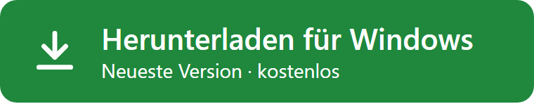
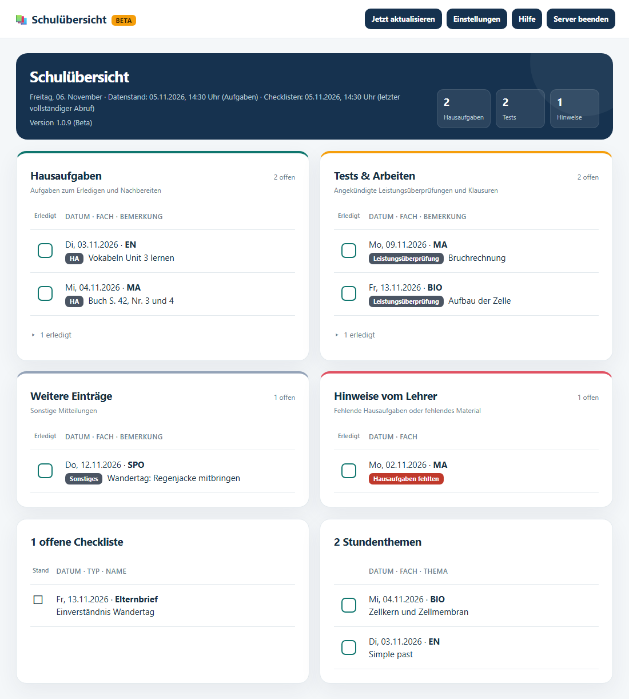
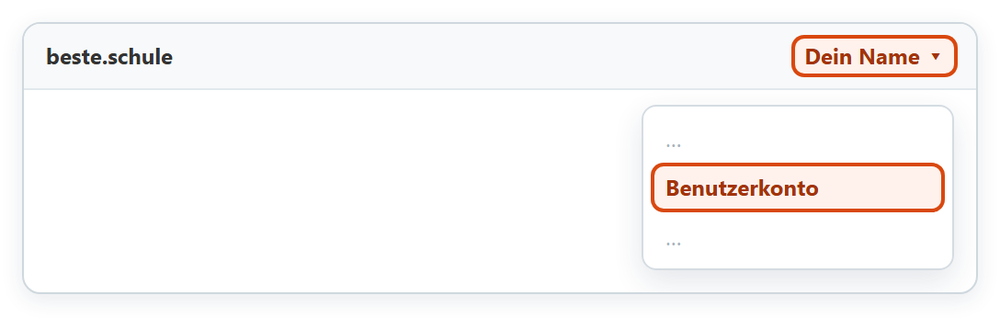
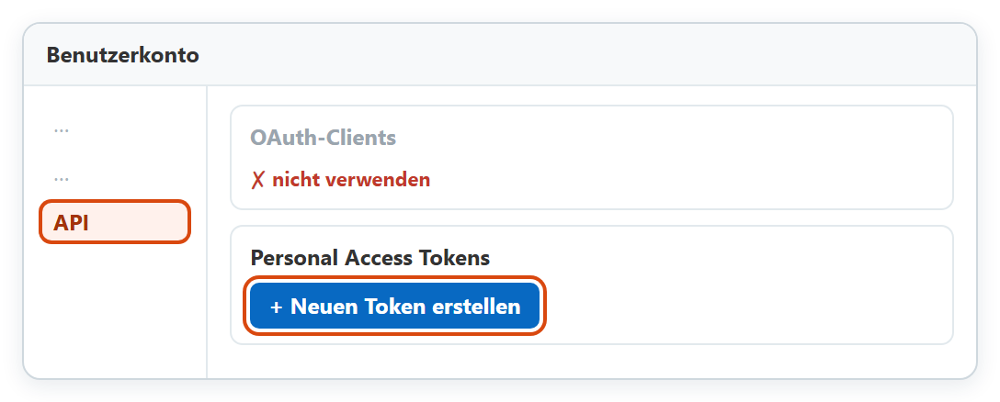
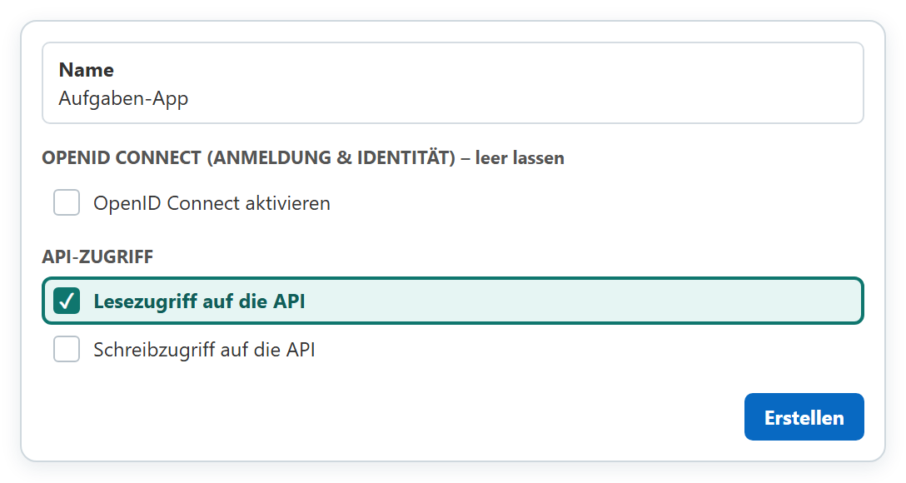
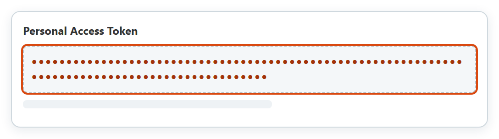
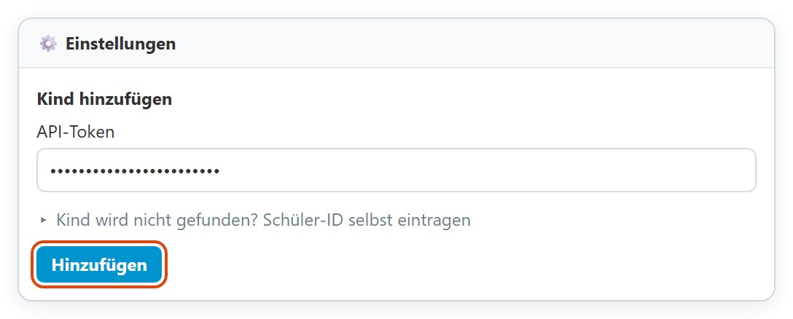
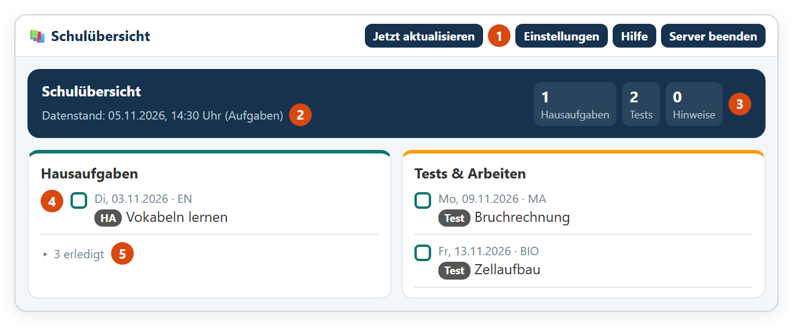

# Aufgaben-App für beste.schule

> **Beta-Version:** Die App wird noch erprobt und kann Fehler enthalten. Wichtige Termine im Zweifel direkt bei beste.schule prüfen. Die App ist kein offizielles Angebot von beste.schule.

Die Aufgaben-App zeigt Hausaufgaben, angekündigte Tests, Hinweise der Lehrkräfte, Checklisten und Stundenthemen aus [beste.schule](https://beste.schule) übersichtlich auf einer Seite. Du kannst Einträge abhaken; die Häkchen bleiben auf deinem Rechner.

- Läuft nur auf deinem Windows-PC, nicht in einer Cloud.
- Liest nur. Bei beste.schule ändert die App nichts.
- Verbindet sich nur mit beste.schule und einmal am Tag mit GitHub, um nach einer neuen Version zu schauen. Keine Werbung, keine Nutzungsstatistik.
- Kostenlos für nicht-kommerzielle Nutzung, der Quellcode ist einsehbar.

Auf der Download-Seite unten unter **Assets** die Datei `Aufgaben-App-<Version>-windows-x64.zip` anklicken. Vor dem Entpacken bitte [Installieren und starten](#installieren-und-starten) lesen.

## Voraussetzungen

- Windows 11, 64 Bit
- Internetverbindung
- ein eigenes beste.schule-Konto, in dem du das Kind siehst
- keine Installation von Node.js oder anderen Programmen, keine Administratorrechte

## Was du herunterlädst

Auf der Seite [Releases](https://github.com/Sunniiii/schuluebersicht/releases) liegen zu jeder Version:

| Datei | Wofür |
|---|---|
| `Aufgaben-App-<Version>-windows-x64.zip` | **Die App.** Nur diese Datei brauchst du. |
| `Aufgaben-App-<Version>-source.zip` | Quellcode genau dieser Version, für Entwicklerinnen und Entwickler |
| `….zip.sha256` | Prüfsumme, um den Download zu kontrollieren |

Die Archive **Source code (zip)** und **Source code (tar.gz)** hängt GitHub automatisch an. Sie enthalten nur diese Beschreibung, nicht die App.

Im Windows-ZIP steckt ein Ordner `Aufgaben-App` mit:

| Datei | Was ist das? |
|---|---|
| `Aufgaben-App starten.cmd` | Startdatei |
| `programm\node.exe` | Laufzeitumgebung Node.js, unverändert und von der OpenJS Foundation signiert |
| `programm\app.js` | die Aufgaben-App selbst |
| `programm\icon.ico` | Symbol für Verknüpfungen |
| `LIESMICH.txt`, `README.md` | Kurzanleitung |
| `LICENSE`, `THIRD-PARTY-NOTICES.txt` | Lizenztexte |
| `SHA256SUMS.txt`, `BUILD.json`, `SECURITY.md` | Prüfsummen, Build-Angaben, Sicherheitshinweise |

Warum eine `.cmd` und keine `.exe`? Eine eigene `.exe` ohne kostenpflichtiges Zertifikat würde Windows blockieren. Die `.cmd` startet stattdessen die signierte `node.exe` von Node.js mit der App.

## Installieren und starten

1. Die Seite [neueste Version](https://github.com/Sunniiii/schuluebersicht/releases/latest) öffnen und unten unter **Assets** auf `Aufgaben-App-<Version>-windows-x64.zip` klicken. Die anderen Dateien brauchst du nicht. Nur von dort laden; zum Weitergeben den Link schicken, nicht die Datei.
2. **Vor dem Entpacken:** Rechtsklick auf die ZIP-Datei → **Eigenschaften** → unten Haken bei **Zulassen** → **OK**. Ohne diesen Schritt blockiert Windows die Startdatei.
3. Das ZIP in einen eigenen Ordner entpacken, zum Beispiel unter **Dokumente**.
4. **Aufgaben-App starten.cmd** doppelklicken. Ein schwarzes Fenster erscheint kurz, dann öffnet sich die App im Browser. Dabei entstehen Verknüpfungen **Aufgaben-App** auf dem Desktop und im Startmenü; künftig startest du die App darüber.

Solange die App läuft, steht unten rechts neben der Uhr ein blaues Symbol mit weißem Haken (eventuell unter dem Pfeil ^). Daran siehst du, dass die App an ist. Doppelklick darauf öffnet sie, Rechtsklick → **Beenden** schließt sie.

## Einrichtung

Die App braucht einmal einen Schlüssel von beste.schule. Dieser Schlüssel heißt dort **Token**. Dein Kind findet die App damit selbst. Die Bilder sind nachgezeichnet; bei beste.schule kann es etwas anders aussehen.

1. Öffne [beste.schule](https://beste.schule). Klicke oben rechts auf deinen Namen. Klicke dann auf **Benutzerkonto**.

   

2. Klicke links auf **API**. Klicke dann auf **+ Neuen Token erstellen**.

   

3. Schreib bei **Name** zum Beispiel `Aufgaben-App`. Setz nur bei **Lesezugriff auf die API** einen Haken. Klicke auf **Erstellen**.

   

4. Jetzt siehst du eine lange Reihe aus Buchstaben und Zahlen. Das ist dein Token. Kopiere es. Du siehst es nur dieses eine Mal.

   

5. Klicke in der Aufgaben-App oben rechts auf **Einstellungen**. Füge das Token ein. Klicke auf **Hinzufügen**.

   

**Fertig!** Jetzt siehst du die Hausaufgaben. Hast du mehrere Kinder, fragt die App, welche sie zeigen soll.

> Das Token ist wie ein Passwort. Gib es niemandem.

**Die App findet dein Kind nicht?** Klicke in den Einstellungen auf **Kind wird nicht gefunden?** und folge dem Hinweis dort.

## Bedienung

1. **Jetzt aktualisieren** holt sofort die neuesten Daten von beste.schule.
2. **Datenstand** zeigt, wann die Daten zuletzt vollständig abgerufen wurden.
3. Die **Zähler** zeigen offene Hausaufgaben, Tests und Hinweise.
4. Mit dem **Kästchen** hakst du einen Eintrag ab.
5. Abgehakte Einträge liegen im eingeklappten Bereich **„… erledigt“**. Dort lässt sich ein Häkchen auch wieder entfernen.

- Beim ersten Öffnen stehen alle Einträge seit Beginn des Schuljahres in der Übersicht. Hake ab, was schon erledigt ist. Ein kurzes Hinweisfenster erklärt das einmal und bietet an, alles, was älter als eine Woche ist, auf einmal abzuhaken. Die letzte Woche bleibt offen, weil Hausaufgaben bei beste.schule das Datum der Stunde tragen, in der sie aufgegeben wurden, nicht den Abgabetag.
- Nur dein Häkchen verschiebt einen Eintrag. Ein Test bleibt auch nach seinem Termin offen, bis du ihn abhakst.
- Wurde eine Stunde getauscht, steht ein Eintrag bei beste.schule manchmal im falschen Fach. Die App zeigt dann beim Fach an, was sonst in dieser Stunde liegt, zum Beispiel **EN (Stundenplanänderung, statt MA)**. Am Inhalt erkennst du, zu welchem Fach der Eintrag gehört.
- Die Häkchen speichert die App nur auf diesem Rechner. Bei beste.schule und auf anderen Geräten sind sie nicht zu sehen.
- Checklisten zeigt die App nur an; abhaken lassen sie sich hier nicht.
- Oben rechts unter **Hilfe** steht eine kurze Anleitung mit Bildern und Lösungen für häufige Probleme.

## Wann werden die Daten abgerufen?

Solange die App läuft, holt sie die Daten beim Start und danach alle **30 Minuten**. **Jetzt aktualisieren** holt sie sofort. Ist die App beendet, wird nichts abgerufen.

| Was | Zeitraum | Wie oft |
|---|---|---|
| Hausaufgaben, Tests, weitere Einträge, Stundenthemen, Hinweise vom Lehrer | das ganze laufende Schuljahr: ab 1. August bis 365 Tage voraus | bei jedem Abruf |
| Checklisten | alle Checklisten des Kindes | bei jedem Abruf; Einzelheiten bereits erledigter Checklisten höchstens alle 24 Stunden |
| Deine Häkchen | nur auf diesem Rechner | sofort beim Anklicken gespeichert |

Vergangene Einträge bleiben offen, bis du sie abhakst. Am 1. August beginnt ein neues Schuljahr: Dann verschwinden die Einträge des alten Schuljahres aus der Übersicht, auch ohne Häkchen.

## Daten und Datenschutz

- Die App läuft nur auf diesem Rechner. Andere Geräte im Heimnetz können sie nicht aufrufen.
- Zugangsdaten und Häkchen liegen in deinem Windows-Profil unter `%APPDATA%\AufgabenApp-BesteSchule`. Das Token ist verschlüsselt und nur mit deinem Windows-Konto lesbar.
- Das Log liegt unter `%LOCALAPPDATA%\AufgabenApp-BesteSchule\logs\server.log`. Das Token steht nie darin.
- Einmal am Tag fragt die App bei GitHub nach, ob es eine neue Version gibt. Dabei schickt sie keine Daten über dich oder dein Kind mit; GitHub sieht nur die IP-Adresse deines Anschlusses. Die App lädt nichts von selbst herunter.
- Kennt jemand anderes dein Token, lösche es bei beste.schule unter **Benutzerkonto** → **API** und erstelle ein neues.

## Update und Entfernen

**Update:** Gibt es eine neue Version, zeigt die App oben in der Übersicht einen grünen Hinweis mit **Herunterladen**. Dann App beenden, das neue ZIP (nach **Zulassen**) in einen neuen Ordner entpacken und dort **Aufgaben-App starten.cmd** starten. Einstellungen und Häkchen bleiben erhalten, die Verknüpfungen zeigen danach auf den neuen Ordner. Den alten Ordner erst löschen, wenn die neue Version läuft.

**Entfernen:** App beenden, Programmordner und Verknüpfungen löschen. Um auch Zugangsdaten, Häkchen und Log zu entfernen, zusätzlich die Ordner `AufgabenApp-BesteSchule` unter `%APPDATA%` und `%LOCALAPPDATA%` löschen.

## Lizenz

Die Aufgaben-App steht unter der [PolyForm Noncommercial License 1.0.0](LICENSE). Kurz gesagt:

- **Erlaubt:** nutzen, weitergeben und verändern für nicht-kommerzielle Zwecke, zum Beispiel privat in der Familie, in Schulen oder in gemeinnützigen Einrichtungen.
- **Nicht erlaubt:** kommerzielle Nutzung, etwa die App zu verkaufen oder in einem bezahlten Angebot oder für ein Unternehmen einzusetzen.
- **Bei der Weitergabe:** den Lizenztext und die Zeile „Required Notice“ aus der Datei [LICENSE](LICENSE) mitgeben.

Verbindlich ist der englische Lizenztext. Die App wird ohne jede Gewährleistung bereitgestellt. Die beigelegte Node.js-Laufzeit und die verwendeten Bibliotheken stehen unter eigenen Lizenzen; die Texte liegen als `THIRD-PARTY-NOTICES.txt` im Paket.

Die App ist kein offizielles Angebot von beste.schule und wird von dessen Betreiber weder geprüft noch unterstützt.

## Sicherheitsprobleme melden

Bitte nicht öffentlich als Issue, sondern wie in [SECURITY.md](SECURITY.md) beschrieben. Niemals Token, Anmeldelinks oder `config.json` in Issues oder Screenshots veröffentlichen.

## Quellcode

Den Quellcode jeder Version gibt es auf der Seite [Releases](https://github.com/Sunniiii/schuluebersicht/releases) als `Aufgaben-App-<Version>-source.zip`. Aufbau, Build und Tests beschreibt die darin enthaltene `ENTWICKLUNG.md`.
