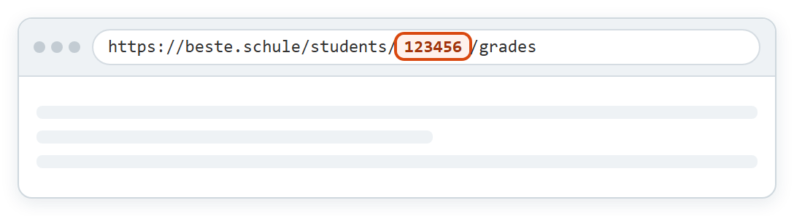

# Aufgaben-App für beste.schule

> **Beta-Version:** Die App wird noch erprobt und kann Fehler enthalten. Wichtige Termine im Zweifel direkt bei beste.schule prüfen. Die App ist kein offizielles Angebot von beste.schule.

Die Aufgaben-App zeigt Hausaufgaben, angekündigte Tests, Hinweise der Lehrkräfte, Checklisten und Stundenthemen aus [beste.schule](https://beste.schule) übersichtlich auf einer Seite. Du kannst Einträge abhaken; die Häkchen bleiben auf deinem Rechner.

- Läuft nur auf deinem Windows-PC, nicht in einer Cloud.
- Liest nur. Bei beste.schule ändert die App nichts.
- Verbindet sich ausschließlich mit beste.schule. Keine Werbung, keine Nutzungsstatistik.
- Kostenlos und quelloffen.

## Voraussetzungen

- Windows 11, 64 Bit
- Internetverbindung
- ein eigenes beste.schule-Konto, in dem du das Kind siehst
- keine Installation von Node.js oder anderen Programmen, keine Administratorrechte

## Was du herunterlädst

Auf der Seite [Releases](../../releases) liegen zu jeder Version:

| Datei | Wofür |
|---|---|
| `Aufgaben-App-<Version>-windows-x64.zip` | **Die App.** Nur diese Datei brauchst du. |
| `Aufgaben-App-<Version>-source.zip` | Quellcode genau dieser Version, für Entwicklerinnen und Entwickler |
| `….zip.sha256` | Prüfsumme, um den Download zu kontrollieren |

Die Archive **Source code (zip)** und **Source code (tar.gz)** hängt GitHub automatisch an. Sie enthalten nur diese Beschreibung, nicht die App.

Im Windows-ZIP steckt ein Ordner `Aufgaben-App` mit:

| Datei | Was ist das? |
|---|---|
| `Aufgaben-App starten.cmd` | Startdatei |
| `programm\node.exe` | Laufzeitumgebung Node.js, unverändert und von der OpenJS Foundation signiert |
| `programm\app.js` | die Aufgaben-App selbst |
| `programm\icon.ico` | Symbol für Verknüpfungen |
| `LIESMICH.txt`, `README.md` | Kurzanleitung |
| `LICENSE`, `THIRD-PARTY-NOTICES.txt` | Lizenztexte |
| `SHA256SUMS.txt`, `BUILD.json`, `SECURITY.md` | Prüfsummen, Build-Angaben, Sicherheitshinweise |

Warum eine `.cmd` und keine `.exe`? Eine eigene `.exe` ohne kostenpflichtiges Zertifikat würde Windows blockieren. Die `.cmd` startet stattdessen die signierte `node.exe` von Node.js mit der App.

## Installieren und starten

1. Das Windows-ZIP von der Seite [Releases](../../releases) herunterladen. Nur von dort laden; zum Weitergeben den Link schicken, nicht die Datei.
2. **Vor dem Entpacken:** Rechtsklick auf die ZIP-Datei → **Eigenschaften** → unten Haken bei **Zulassen** → **OK**. Ohne diesen Schritt blockiert Windows die Startdatei.
3. Das ZIP in einen eigenen Ordner entpacken, zum Beispiel unter **Dokumente**.
4. **Aufgaben-App starten.cmd** doppelklicken. Ein schwarzes Fenster erscheint kurz, dann öffnet sich der Browser mit der Einrichtung. Dabei entstehen Verknüpfungen **Aufgaben-App** auf dem Desktop und im Startmenü; künftig startest du die App darüber.

Solange die App läuft, steht ein Symbol im Infobereich unten rechts (eventuell unter dem Pfeil ^). Darüber öffnest oder beendest du die App.

## Einrichtung

Beim ersten Start fragt die App nach zwei Angaben aus beste.schule und zeigt dort dieselbe Anleitung. Die Bilder sind nachgezeichnet; die Oberfläche von beste.schule kann leicht abweichen.

### 1. Schüler-ID finden

Bei [beste.schule](https://beste.schule) anmelden und die Notenübersicht des Kindes öffnen. In der Adresszeile des Browsers steht dann zum Beispiel `beste.schule/students/123456/grades`. Die Zahl zwischen `/students/` und `/grades` ist die Schüler-ID.

### 2. API-Token erstellen

Mit dem Token darf die App die Daten bei beste.schule lesen. Es gehört zu deinem Benutzerkonto und kann für mehrere Kinder gelten.

1. Bei beste.schule oben rechts auf deinen Namen klicken und **Benutzerkonto** wählen.

   

2. Links **API** anklicken. Nach unten zu **Personal Access Tokens** scrollen, nicht **OAuth-Clients** verwenden. Auf **+ Neuen Token erstellen** klicken.

   

3. Bei **Name** zum Beispiel `Aufgaben-App` eintragen. Unter **OPENID CONNECT** alle Kästchen leer lassen. Unter **API-ZUGRIFF** nur **Lesezugriff auf die API** ankreuzen, **Schreibzugriff auf die API** leer lassen. Unten rechts auf **Erstellen** klicken.

   

4. Das Token wird nur **einmal** angezeigt. Sofort vollständig kopieren.

   

> Das Token wie ein Passwort behandeln und nicht weitergeben. Nicht das beste.schule-Passwort oder den Zugangsschlüssel der Schule eintragen.

### 3. In der App eintragen

Schüler-ID und Token in das Einrichtungsformular einfügen und **Speichern & starten** klicken. Die App prüft die Angaben sofort bei beste.schule und meldet, wenn etwas nicht passt.

Weitere Kinder legst du später unter **Einstellungen** → **Kind hinzufügen** an.

## Bedienung

1. **Jetzt aktualisieren** holt sofort die neuesten Daten von beste.schule.
2. **Datenstand** zeigt, wann die Daten zuletzt vollständig abgerufen wurden.
3. Die **Zähler** zeigen offene Hausaufgaben, Tests und Hinweise.
4. Mit dem **Kästchen** hakst du einen Eintrag ab.
5. Abgehakte Einträge liegen im eingeklappten Bereich **„… erledigt“**. Dort lässt sich ein Häkchen auch wieder entfernen.

- Nur dein Häkchen verschiebt einen Eintrag. Ein Test bleibt auch nach seinem Termin offen, bis du ihn abhakst.
- Die Häkchen speichert die App nur auf diesem Rechner. Bei beste.schule und auf anderen Geräten sind sie nicht zu sehen.
- Checklisten zeigt die App nur an; abhaken lassen sie sich hier nicht.
- Oben rechts unter **Hilfe** steht eine ausführliche Anleitung mit Lösungen für häufige Probleme.

## Wann werden die Daten abgerufen?

Solange die App läuft, holt sie die Daten beim Start und danach alle **30 Minuten**. **Jetzt aktualisieren** holt sie sofort. Ist die App beendet, wird nichts abgerufen.

| Was | Zeitraum | Wie oft |
|---|---|---|
| Hausaufgaben, Tests, weitere Einträge, Stundenthemen | 30 Tage zurück bis 365 Tage voraus | bei jedem Abruf |
| Hinweise vom Lehrer | vom 1. August des laufenden Schuljahres bis heute | bei jedem Abruf |
| Checklisten | alle Checklisten des Kindes | bei jedem Abruf; Einzelheiten bereits erledigter Checklisten höchstens alle 24 Stunden |
| Deine Häkchen | nur auf diesem Rechner | sofort beim Anklicken gespeichert |

Einträge, deren Unterrichtsstunde mehr als 30 Tage zurückliegt, ruft die App nicht mehr ab. Sie verschwinden dann aus der Übersicht, auch ohne Häkchen.

## Daten und Datenschutz

- Die App läuft nur auf diesem Rechner. Andere Geräte im Heimnetz können sie nicht aufrufen.
- Zugangsdaten und Häkchen liegen in deinem Windows-Profil unter `%APPDATA%\AufgabenApp-BesteSchule`. Das Token ist verschlüsselt und nur mit deinem Windows-Konto lesbar.
- Das Log liegt unter `%LOCALAPPDATA%\AufgabenApp-BesteSchule\logs\server.log`. Das Token steht nie darin.
- Kennt jemand anderes dein Token, lösche es bei beste.schule unter **Benutzerkonto** → **API** und erstelle ein neues.

## Update und Entfernen

**Update:** App beenden, das neue ZIP (nach **Zulassen**) in einen neuen Ordner entpacken und dort **Aufgaben-App starten.cmd** starten. Einstellungen und Häkchen bleiben erhalten, die Verknüpfungen zeigen danach auf den neuen Ordner. Den alten Ordner erst löschen, wenn die neue Version läuft.

**Entfernen:** App beenden, Programmordner und Verknüpfungen löschen. Um auch Zugangsdaten, Häkchen und Log zu entfernen, zusätzlich die Ordner `AufgabenApp-BesteSchule` unter `%APPDATA%` und `%LOCALAPPDATA%` löschen.

## Lizenz

Die Aufgaben-App ist freie Software unter der [GNU General Public License Version 3](LICENSE). Sie wird ohne jede Gewährleistung bereitgestellt. Die beigelegte Node.js-Laufzeit und die verwendeten Bibliotheken stehen unter eigenen Lizenzen; die Texte liegen als `THIRD-PARTY-NOTICES.txt` im Paket.

Die App ist kein offizielles Angebot von beste.schule und wird von dessen Betreiber weder geprüft noch unterstützt.

## Sicherheitsprobleme melden

Bitte nicht öffentlich als Issue, sondern wie in [SECURITY.md](SECURITY.md) beschrieben. Niemals Token, Anmeldelinks oder `config.json` in Issues oder Screenshots veröffentlichen.

## Quellcode

Den Quellcode jeder Version gibt es auf der Seite [Releases](../../releases) als `Aufgaben-App-<Version>-source.zip`. Aufbau, Build und Tests beschreibt die darin enthaltene `ENTWICKLUNG.md`.
